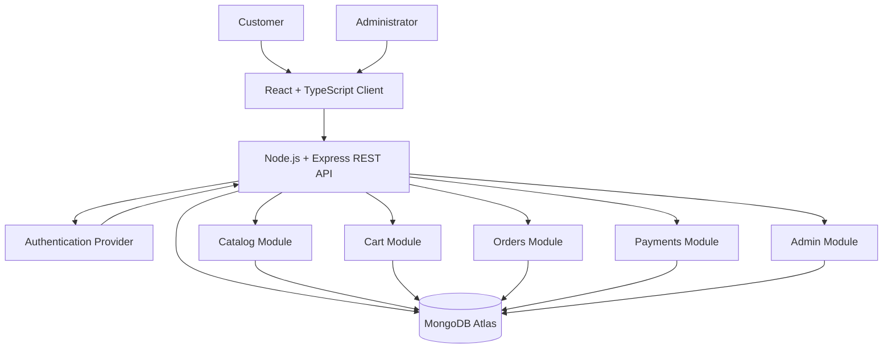

# ShopSphere System Architecture

## 1. Overview

ShopSphere is a full-stack e-commerce platform. Customers can browse products, manage a shopping cart, place orders, and complete payments. Administrators manage the product catalog and orders.

## 2. System Architecture

## 3. Technology Stack

- **Frontend:** React, TypeScript, Tailwind CSS
- **Backend:** Node.js, Express.js, REST APIs
- **Database:** MongoDB Atlas
- **Authentication:** Authentication provider integration planned behind a dedicated authentication boundary
- **API format:** JSON over HTTP

## 4. Module Boundaries

| Module | Collection ownership | Example endpoints |
|---|---|---|
| Auth | users | POST /api/auth/register, POST /api/auth/login, GET /api/auth/me |
| Catalog | products, categories | GET /api/products, GET /api/products/:id, POST /api/products |
| Cart | carts | GET /api/cart, POST /api/cart/items, PATCH /api/cart/items/:itemId, DELETE /api/cart/items/:itemId |
| Orders | orders | POST /api/orders, GET /api/orders, GET /api/orders/:id |
| Payments | payments | POST /api/payments, GET /api/payments/:id |
| Admin | admin-managed catalog and order operations | GET /api/admin/dashboard, PATCH /api/admin/orders/:id/status |

These are planned module boundaries and endpoint contracts. They will be implemented in later tasks. Authentication and authorization must protect customer and administrator operations.

## 5. Request Flow

1. The customer interacts with the React client.
2. The client sends an HTTP request to the Express REST API.
3. Authentication and authorization are checked where required.
4. The relevant module validates the request and performs its operation.
5. Data is read from or written to MongoDB Atlas.
6. The API returns a JSON response to the client.

## 6. Security and Reliability

- Keep database credentials in environment variables.
- Never commit `.env` files or secrets.
- Validate request bodies and route parameters.
- Enforce authentication and role-based authorization.
- Do not store raw payment card details.
- Verify payment results with the payment provider before marking orders as paid.

## 7. Architecture Decisions

See the Architecture Decision Records in `docs/adr/`.
