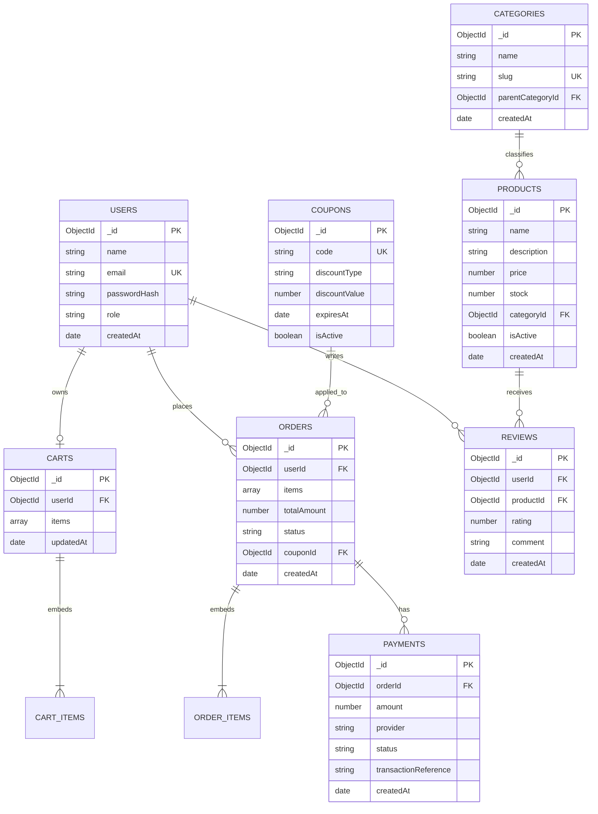

# ShopSphere Database Design

## 1. Overview

ShopSphere uses MongoDB with Mongoose. The database is organized into eight collections: `users`, `products`, `categories`, `carts`, `orders`, `payments`, `reviews`, and `coupons`.

MongoDB automatically assigns an `_id` field of type `ObjectId` to each document unless configured otherwise. Mongoose schemas should enforce required fields, defaults, validation, and relationships at the application layer.

## 2. ER Diagram

The diagram shows logical relationships. `CART_ITEMS` and `ORDER_ITEMS` are embedded arrays inside carts and orders, not separate collections.

## 3. Reference vs. Embedding Decisions

| Relationship or data | Decision | Reason |
|---|---|---|
| Product → Category | Reference `categoryId` | Categories can be shared and updated independently |
| Cart → User | Reference `userId` | A cart belongs to a user |
| Cart → Items | Embed item snapshots | Items are read and updated with the cart |
| Order → User | Reference `userId` | Users can have many orders |
| Order → Items | Embed item snapshots | Preserve purchased name, quantity, and price even if the product changes later |
| Payment → Order | Reference `orderId` | An order may have multiple payment attempts |
| Review → User and Product | Reference both IDs | Supports product reviews and user review history |
| Order → Coupon | Optional `couponId` reference | Coupons are managed independently |
| Category → Parent category | Optional `parentCategoryId` reference | Supports category hierarchies |

Embedded cart item fields: `productId`, `quantity`, and optionally a display snapshot of `name` and `unitPrice`.

Embedded order item fields: `productId`, `name`, `unitPrice`, and `quantity`. The order stores the price at purchase time.

Do not store raw card numbers, CVVs, passwords, or payment-provider secrets in these documents.

## 4. Collection Field Specifications

`ObjectId` fields marked `ref` reference another collection. Unless stated otherwise, `_id` is automatically generated by MongoDB.

### 4.1 Users

| Field | Type | Required | Default / rule |
|---|---|---|---|
| `_id` | ObjectId | Yes | Auto-generated |
| `name` | String | Yes | Trimmed; non-empty |
| `email` | String | Yes | Lowercase, trimmed; unique |
| `passwordHash` | String | Yes | Hashed password only |
| `role` | String | Yes | `customer`; allowed values should be validated |
| `createdAt` | Date | Yes | Current time |
| `updatedAt` | Date | Yes | Current time; update on changes |

### 4.2 Products

| Field | Type | Required | Default / rule |
|---|---|---|---|
| `_id` | ObjectId | Yes | Auto-generated |
| `name` | String | Yes | Trimmed; non-empty |
| `description` | String | No | Empty string |
| `price` | Number | Yes | Must be greater than or equal to zero |
| `stock` | Number | Yes | `0`; non-negative integer |
| `categoryId` | ObjectId (`categories`) | Yes | Must reference a category |
| `imageUrls` | Array of Strings | No | Empty array |
| `isActive` | Boolean | Yes | `true` |
| `createdAt` | Date | Yes | Current time |
| `updatedAt` | Date | Yes | Current time; update on changes |

### 4.3 Categories

| Field | Type | Required | Default / rule |
|---|---|---|---|
| `_id` | ObjectId | Yes | Auto-generated |
| `name` | String | Yes | Trimmed |
| `slug` | String | Yes | Unique, URL-friendly |
| `description` | String | No | Empty string |
| `parentCategoryId` | ObjectId (`categories`) | No | No parent |
| `isActive` | Boolean | Yes | `true` |
| `createdAt` | Date | Yes | Current time |
| `updatedAt` | Date | Yes | Current time; update on changes |

### 4.4 Carts

| Field | Type | Required | Default / rule |
|---|---|---|---|
| `_id` | ObjectId | Yes | Auto-generated |
| `userId` | ObjectId (`users`) | Yes | One active cart per user |
| `items` | Array of embedded objects | Yes | Empty array |
| `items[].productId` | ObjectId (`products`) | Yes | Product reference |
| `items[].quantity` | Number | Yes | Positive integer |
| `items[].name` | String | No | Optional display snapshot |
| `items[].unitPrice` | Number | No | Optional display snapshot; validate non-negative |
| `updatedAt` | Date | Yes | Current time; update on changes |

Enforce a unique index on `userId` if the design permits only one active cart per user.

### 4.5 Orders

| Field | Type | Required | Default / rule |
|---|---|---|---|
| `_id` | ObjectId | Yes | Auto-generated |
| `userId` | ObjectId (`users`) | Yes | Order owner |
| `items` | Array of embedded objects | Yes | Must contain at least one item |
| `items[].productId` | ObjectId (`products`) | Yes | Product reference |
| `items[].name` | String | Yes | Purchase-time snapshot |
| `items[].unitPrice` | Number | Yes | Purchase-time price; non-negative |
| `items[].quantity` | Number | Yes | Positive integer |
| `totalAmount` | Number | Yes | Calculated server-side; non-negative |
| `status` | String | Yes | `pending`; validate allowed states |
| `couponId` | ObjectId (`coupons`) | No | Omitted if no coupon |
| `shippingAddress` | Embedded object | Yes | Snapshot of delivery address |
| `createdAt` | Date | Yes | Current time |
| `updatedAt` | Date | Yes | Current time; update on changes |

Example order statuses: `pending`, `confirmed`, `shipped`, `delivered`, `cancelled`. Allowed transitions should be enforced by business logic.

### 4.6 Payments

| Field | Type | Required | Default / rule |
|---|---|---|---|
| `_id` | ObjectId | Yes | Auto-generated |
| `orderId` | ObjectId (`orders`) | Yes | Related order |
| `amount` | Number | Yes | Non-negative |
| `provider` | String | Yes | Payment provider identifier |
| `status` | String | Yes | `pending`; validate allowed states |
| `transactionReference` | String | No | Provider reference; unique when present |
| `currency` | String | Yes | `INR` |
| `createdAt` | Date | Yes | Current time |
| `updatedAt` | Date | Yes | Current time; update on changes |

Never store card security codes or raw payment credentials. Verify payment status using trusted provider confirmation.

### 4.7 Reviews

| Field | Type | Required | Default / rule |
|---|---|---|---|
| `_id` | ObjectId | Yes | Auto-generated |
| `userId` | ObjectId (`users`) | Yes | Review author |
| `productId` | ObjectId (`products`) | Yes | Reviewed product |
| `rating` | Number | Yes | Integer from 1 to 5 |
| `comment` | String | No | Empty string |
| `createdAt` | Date | Yes | Current time |
| `updatedAt` | Date | Yes | Current time; update on changes |

A unique compound index on `(userId, productId)` enforces at most one review per user per product. If multiple reviews are allowed, remove that uniqueness rule.

### 4.8 Coupons

| Field | Type | Required | Default / rule |
|---|---|---|---|
| `_id` | ObjectId | Yes | Auto-generated |
| `code` | String | Yes | Uppercase, trimmed, unique |
| `discountType` | String | Yes | `percentage` or `fixed` |
| `discountValue` | Number | Yes | Positive number; percentage capped at 100 |
| `minOrderAmount` | Number | No | `0` |
| `maxDiscountAmount` | Number | No | No cap for fixed discounts; business-rule validation |
| `startsAt` | Date | Yes | Current time |
| `expiresAt` | Date | Yes | Must be after `startsAt` |
| `usageLimit` | Number | No | No limit if omitted |
| `usedCount` | Number | Yes | `0` |
| `isActive` | Boolean | Yes | `true` |
| `createdAt` | Date | Yes | Current time |

Coupon eligibility and usage limits must be validated server-side. Use atomic updates or transactions where necessary to prevent overspending usage limits.

## 5. Index Plan

Indexes should support common queries while avoiding unnecessary write overhead.

| Collection | Index | Purpose |
|---|---|---|
| `users` | `{ email: 1 }`, unique | Login and duplicate-email prevention |
| `products` | `{ categoryId: 1, isActive: 1 }` | Filter active products by category |
| `products` | `{ createdAt: -1 }` | Recently added products |
| `products` | `{ name: "text", description: "text" }` | Basic catalog text search, if required |
| `categories` | `{ slug: 1 }`, unique | Category lookup by URL slug |
| `categories` | `{ parentCategoryId: 1, isActive: 1 }` | Category hierarchy |
| `carts` | `{ userId: 1 }`, unique | Find one cart per user |
| `orders` | `{ userId: 1, createdAt: -1 }` | User order history |
| `orders` | `{ status: 1, createdAt: -1 }` | Filter orders by status |
| `payments` | `{ orderId: 1, createdAt: -1 }` | Payment attempts for an order |
| `payments` | `{ transactionReference: 1 }`, unique sparse/partial | Find provider transactions when reference exists |
| `reviews` | `{ productId: 1, createdAt: -1 }` | Product reviews |
| `reviews` | `{ userId: 1, productId: 1 }`, unique | One review per user/product |
| `coupons` | `{ code: 1 }`, unique | Coupon lookup |
| `coupons` | `{ isActive: 1, expiresAt: 1 }` | Candidate active coupons |

Use a partial unique index for `transactionReference` if missing or null references are permitted. Confirm actual query patterns with MongoDB explain plans before adding further indexes. A text index supports basic text search; use a dedicated search service if advanced relevance, filtering, or autocomplete is required.

## 6. Data Integrity and Security

- Validate types, required fields, enumerated values, and numeric ranges in Mongoose schemas and request validation.
- Enforce uniqueness with database indexes, not application checks alone.
- Calculate totals and discounts on the server; never trust prices or totals submitted by a client.
- Use purchase-time product snapshots in orders.
- Protect user-specific data with authorization checks.
- Use transactions for multi-document operations when supported by the deployment and required for consistency.
- Keep `.env` and all credentials out of Git.
- Add indexes based on measured query patterns and expected data volume.

## 7. Scope Note

This document defines the planned database model. It does not claim that all eight Mongoose models, indexes, or business workflows have already been implemented.